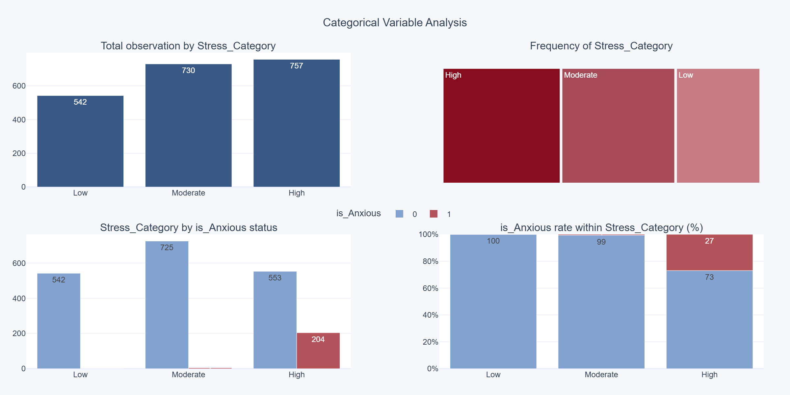
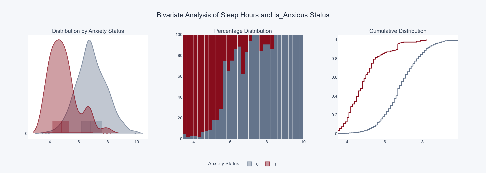
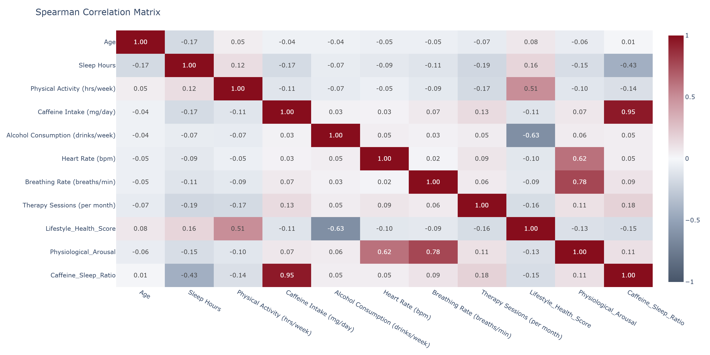

# Social Anxiety: Data Cleaning & Exploratory Analysis

An end-to-end exploratory analysis of a social anxiety dataset (~2,000 people, 22 columns), starting from a messy CSV and ending with statistical tests. The goal is to find out which lifestyle, physiological and demographic factors go hand in hand with being labelled anxious (`is_Anxious`).

The focus is less on modelling and more on doing the groundwork properly: cleaning the data carefully, picking tests that fit the data, and being honest about what the results can and can't tell us.

## What's inside

**Data cleaning**
- Found and dropped a duplicated column (`Target` was an exact copy of `is_Anxious`).
- Turned impossible values (negative sleep hours, a stress score of 15 on a 1–10 scale, etc.) into missing values, with flag columns to keep track of what was changed.
- Capped outliers with the IQR rule, again with flag columns.
- Filled missing values with the median (numeric and ordinal columns) or the most common value (categorical columns). Medians were used because none of the numeric columns are normally distributed.

**Feature engineering**
- `Lifestyle_Health_Score`: combines physical activity, diet quality and alcohol use.
- `Physiological_Arousal`: heart rate × breathing rate, scaled to 0–1.
- `Caffeine_Sleep_Ratio`: caffeine per hour of sleep.
- Bins based on common reference points (7–9 h of sleep, 400 mg caffeine/day, 100 bpm heart rate, …) and occupations grouped into broader categories.

**Analysis**

| Comparison | Charts | Test |
|---|---|---|
| Categorical vs. target | bar charts, treemap, anxiety rate per group | Chi-Square + Cramér's V |
| Two categoricals vs. target | heatmap, grouped bars | Binomial GLM + likelihood ratio tests, BH-adjusted |
| Numeric, one at a time | violin, histogram + normal fit, Q-Q plot | Shapiro-Wilk |
| Numeric vs. target | violin, normalized histogram, ECDF | t-test / Mann-Whitney U + bootstrap CI |
| Ordinal vs. target | — | Mann-Whitney U |
| Numeric vs. numeric | correlation matrix, scatter + heatmap | Spearman |

## Key findings

About 10% of people in the data are labelled anxious.

- **Sleep, stress, caffeine and activity matter most.** Anxious people sleep about 4.9 hours a night versus 6.9 for everyone else, drink more coffee (about 443 vs. 276 mg/day) and are much less active (about 1.3 vs. 3.2 hours/week). Among short sleepers, 24% are anxious, compared with 2% of those sleeping 6.5–9 hours.
- **Stress level shows a sharp step.** Almost nobody with low or moderate stress is anxious; among people with high stress it's about 27%.
- **Therapy has the strongest association (Cramér's V ≈ 0.54),** but this is almost certainly reverse causation: people go to therapy *because* they're anxious.
- **Demographics barely matter.** Gender and occupation show no significant association.
- **The engineered features hold up.** `Caffeine_Sleep_Ratio` has a moderate correlation with anxiety level (Spearman ρ ≈ 0.35).





## Limitations

- **Correlation, not causation.** Nothing here shows what causes anxiety.
- **The data looks at least partly synthetic.** Several groups have *exactly* zero anxious people (no therapy, low stress, long sleep), which is very unusual for real-world data. The label was most likely generated by rules, so the patterns may say more about how the dataset was built than about people.
- **The label seems to come from `Anxiety Level`.** The anxious group has a median anxiety score of 9 versus 3, so these two shouldn't be treated as independent.
- **Pair selection was exploratory.** The categorical pairs in the two-variable analysis were picked by trying out combinations, so those results should be read as hypotheses rather than conclusions. Some combinations also have zero anxious people, which makes the logistic regression p-values unreliable (perfect separation).
- **`Therapy History` is about 90% empty,** so results based on it use only a small part of the data.

## Running it

```bash
pip install numpy pandas matplotlib plotly scipy statsmodels kaleido
plotly_get_chrome

```

Place `social_anxiety_dataset.csv` next to the notebook.

**Figures:** with `SAVE_FIGURES = True` (the default), every chart is saved to `figures/`. Plotly charts are saved as PNG when `kaleido` works (it needs Chrome, which `plotly_get_chrome` installs), and as interactive HTML otherwise.

**Viewing on GitHub:** GitHub doesn't render interactive Plotly charts. Either set `STATIC_PLOTS = True` before the final run, or open the notebook through [nbviewer](https://nbviewer.org/) to see the interactive version.

## Repository structure

```
├── EDA & Analysis.ipynb
├── social_anxiety_dataset.csv
├── figures/
└── README.md
```

## Tools

Python · pandas · NumPy · SciPy · statsmodels · Plotly · Matplotlib
